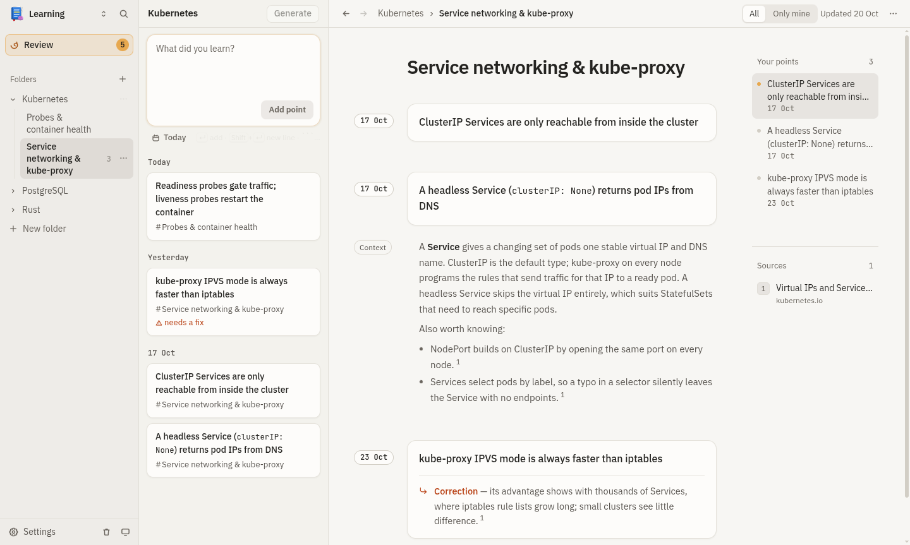
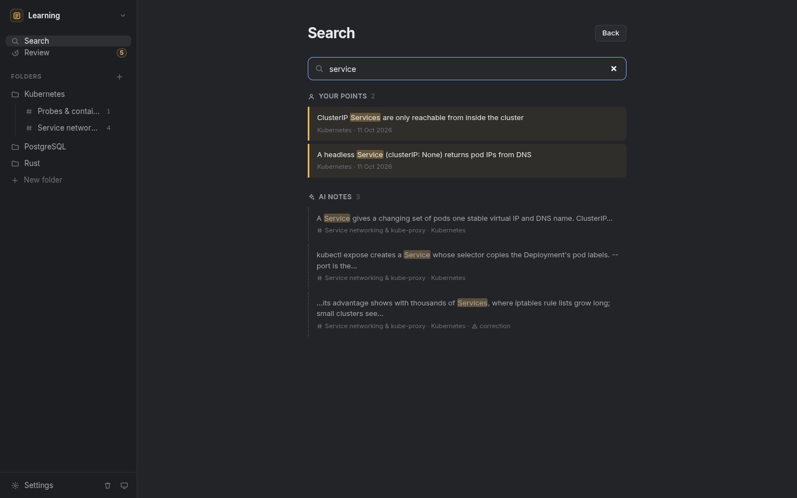
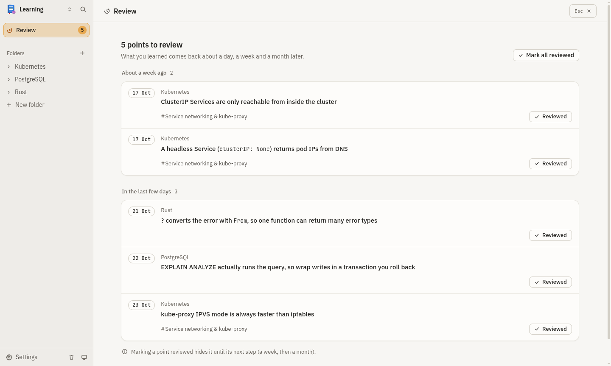

<div align="center">


# Lode

**Capture what you learn, one line at a time. An LLM turns it into notes. Your own words stay yours.**

[](https://gitlab.com/mohotta/lode/-/pipelines)
[](https://gitlab.com/mohotta/lode/-/releases)
[](LICENSE)

[Download](#download) · [Features](#features) · [How it works](#how-it-works) · [Build from source](#build-from-source) · [Contributing](CONTRIBUTING.md)

</div>

<p align="center">
  
</p>

Lode is a local-first desktop app for developers who keep a daily learning log but never get a useful recap out of it. You jot short **points** into a folder's scratchpad, the way you'd add lines to a backlog. When you press **Generate**, an LLM you choose files them into **subtopic notes**, explains them, adds a few web-sourced "also worth knowing" facts, and flags anything you got wrong. **Your points stay visibly highlighted** and are never rewritten, so you can always tell what you learned from what the AI added.

Everything is plain markdown in a folder you pick. There is no account, no server and no telemetry. You bring your own API key.

## Features

- **Fast capture.** One input per folder; Enter adds a point. Code fences, inline code and lists render as markdown. Backfill a past day with the date chip.
- **LLM-organised notes.** Generate files unfiled points into existing or new subtopics, with a short explanation and sourced extras for each group.
- **Your points, untouched.** Notes store `{{point:id}}` markers, never copies of your text. Your points are the main text with a solid rule and their date in the margin; AI text is muted prose with a dotted rule and a "generated" label.
- **Corrections, not rewrites.** If a point is wrong, a separate sourced correction appears under it and the point is marked *Needs a fix*. Your text stays as you wrote it.
- **Verifiable sources.** With web search on (Tavily), every added fact must cite a URL from that run's search results; anything else is dropped or marked unsourced.
- **Works in the background.** Generate, Regenerate and digests queue in a status bar while you keep capturing.
- **Recap.** *Review* resurfaces points from about a day, a week and a month ago. *Search* (Ctrl+K) covers points and notes, listed apart. *Digests* write a weekly or monthly recap. *My points* hides the AI text.
- **Housekeeping.** Edit or delete points (soft delete, restorable), regenerate a note with undo, move notes and folders to a vault trash, and get a warning when you add a point that repeats an earlier one.

<table>
  <tr>
    <td></td>
    <td></td>
  </tr>
  <tr>
    <td align="center"><sub>Search keeps your points apart from AI text</sub></td>
    <td align="center"><sub>Review brings points back to read again</sub></td>
  </tr>
</table>

## Download

Get the latest build from the **[Releases page](https://gitlab.com/mohotta/lode/-/releases)**. Builds are currently Linux x86-64 only and unsigned.

| Format | Install |
|---|---|
| **AppImage** (any distribution) | `chmod +x Lode-*-x86_64.AppImage && ./Lode-*-x86_64.AppImage` |
| **deb** (Debian, Ubuntu, Mint) | `sudo apt install ./lode_*_amd64.deb` |
| **rpm** (Fedora, openSUSE) | `sudo dnf install ./lode-*.x86_64.rpm` |

Windows and macOS installers can be built from source (see [Packaging](#packaging)); official builds for them are planned.

## Getting started

1. **Open or create a vault.** Pick any directory. Lode keeps it as plain markdown you can open in any editor.
2. **Create a folder** (for example "Kubernetes") and type what you learned. Enter adds a point; Shift+Enter starts a new line.
3. **Settings.** Enter an OpenAI-compatible base URL and model, then save your LLM key ([OpenRouter](guides/openrouter.md) or [Groq](guides/groq.md) guide). Optionally add a [Tavily key](guides/tavily.md) so the model can search the web and cite sources.
4. **Generate.** Check the preview (points, model, token estimate, search on or off) and confirm. Follow the job in the status bar and click it for the report.

### LLM providers

> **Lode uses the OpenAI API format** (Chat Completions with tool calling). Any provider with an OpenAI-compatible endpoint works: set its base URL, model ID and key in Settings.

| Provider | Base URL | Key guide |
|---|---|---|
| OpenRouter (hundreds of models, one key) | `https://openrouter.ai/api/v1` | [guides/openrouter.md](guides/openrouter.md) |
| Groq (fast open models, free tier) | `https://api.groq.com/openai/v1` | [guides/groq.md](guides/groq.md) |
| OpenAI | `https://api.openai.com/v1` | [platform.openai.com/api-keys](https://platform.openai.com/api-keys) |
| Ollama (local, no key) | `http://localhost:11434/v1` | |
| LiteLLM, vLLM, LM Studio and other gateways | your gateway's `/v1` URL | |

For web search, the model must support tool calling and you need a Tavily key: see [guides/tavily.md](guides/tavily.md). Native Anthropic and Gemini adapters are on the roadmap.

## Privacy and your data

- **Local-first.** Your vault is a folder of markdown files on your disk. Lode has no backend and sends no telemetry.
- **Explicit sends only.** Point text leaves your machine only when you press Generate, Regenerate or write a digest, and only to the LLM and search providers you configured. The preview shows what will be sent.
- **Keys stay in the OS keychain** (via Electron `safeStorage`). The interface can save, test and clear a key but never read it back. On Linux without a keyring, keys are only obfuscated, so Lode asks before storing them.
- **Spellcheck dictionaries.** On Linux, the spellchecker downloads its dictionary for your language from Google's CDN the first time it runs (Electron's built-in behaviour). Only the dictionary file is fetched; none of your text is sent. Windows and macOS use the OS spellchecker.
- **Generation can't touch your backlog.** The code that talks to the model gets a read-only view of your points, and the test suite checks that backlog files stay byte-identical across generation runs.

## How it works

```
my-vault/
├── .lode/                       # app data: history, trash, review marks, search index
└── kubernetes/
    ├── folder.json
    ├── backlog/2026-10-17.md    # your points, one file per day
    ├── notes/service-networking.md
    └── digests/2026-W42.md
```

A backlog day is a markdown list. Each point carries a stable ID in Obsidian block-ID syntax:

```markdown
---
date: 2026-10-17
deleted: []
---
- ClusterIP services are only reachable inside the cluster ^p-k3x9a2bq
```

A note refers to your points by ID and holds the AI text in fenced blocks:

```markdown
{{point:p-k3x9a2bq}}

::llm{id=b-01 model="openai-compatible/gpt-5-mini" at="2026-10-17T10:42:00Z"}
ClusterIP is the default Service type...

Also worth knowing:
- NodePort builds on ClusterIP by opening a port on every node. [Service](https://kubernetes.io/docs/concepts/services-networking/service/)
::
```

Model output is validated with a strict schema: point IDs must come from the current run, `{{point:` and `::` markers are stripped so the model can't forge structure, and links must come from that run's search results.

## Build from source

Requirements: **Node.js 24+** and **pnpm** (via Corepack).

```bash
git clone https://gitlab.com/mohotta/lode.git
cd lode
corepack enable
pnpm install
pnpm dev            # run with hot reload
```

pnpm 12 only runs dependency build scripts listed under `allowBuilds` in `pnpm-workspace.yaml`. If Electron's binary is missing after install, run `node node_modules/electron/install.js`.

### Checks

```bash
pnpm typecheck && pnpm lint && pnpm test    # types, lint, unit + integration tests
pnpm test:e2e                               # builds, then drives Electron against fake LLM/search servers
```

### Packaging

```bash
pnpm package        # Linux → dist/: AppImage, deb, rpm
pnpm package:win    # Windows NSIS installer (run on Windows)
pnpm package:mac    # macOS dmg (run on macOS)
```

deb and rpm use electron-builder's bundled fpm, which needs `libcrypt.so.1` (on Fedora: `sudo dnf install libxcrypt-compat`). To run the end-to-end suite against a packaged build: `LODE_E2E_EXECUTABLE=dist/linux-unpacked/lode pnpm exec playwright test`.

### Project layout

```
src/core/       shell-agnostic logic: formats, repos, generation, LLM adapters, search index (no Electron imports)
src/main/       Electron main process: IPC handlers, key storage, windows
src/preload/    the typed contextBridge API (one method per channel, no generic passthrough)
src/shared/     types and Zod schemas shared by main and renderer
src/renderer/   React UI
tests/          unit, integration, e2e (Playwright + Electron), fixtures
```

Built with Electron, React, TypeScript, electron-vite, Zod, react-markdown and SQLite FTS5 (`node:sqlite`).

## Releases

Releases are cut by CI from version tags:

1. Bump `"version"` in `package.json` and merge to `main`.
2. Tag that commit with the same version and push the tag: `git tag v0.2.0 && git push origin v0.2.0`.
3. The pipeline runs the checks, builds the Linux packages, smoke-tests the packaged app, uploads the files to the Package Registry and publishes a release with download links.

## Roadmap

- Native Anthropic, OpenAI and Gemini adapters, and a separate model for digests
- More web search providers besides Tavily (such as Brave Search, Exa, SearXNG for self-hosting) and providers' built-in search tools
- Watching the vault for edits made in other editors
- Moving a point between subtopics by hand
- Signed Windows and macOS builds, Flatpak
- Optional auto-update

## Contributing

Bug reports, ideas and merge requests are welcome. Read [CONTRIBUTING.md](CONTRIBUTING.md) first; it covers setup, the checks to run and the invariants every change must keep. To report a security issue, see [SECURITY.md](SECURITY.md).

## License

Copyright © 2026 Kumudu Mohottala.

Lode is free software: you can redistribute it and/or modify it under the terms of the [GNU General Public License](LICENSE) as published by the Free Software Foundation, either version 3 of the License, or (at your option) any later version (`GPL-3.0-or-later`). It is distributed in the hope that it will be useful, but **without any warranty**; see the license for details.
